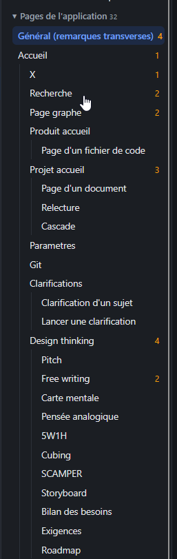

# REC-102 : il me faut de quoi replier les cascades

il me faut de quoi replier les cascades

## Traitement

**traitee** : Les arborescences du volet (pages de réception, cascade besoin → exigences → tests) se replient nœud par nœud avec un triangle, fermées à l'arrivée, et ⊟/⊞ replie ou déplie tout.

Commit : `f793367`
