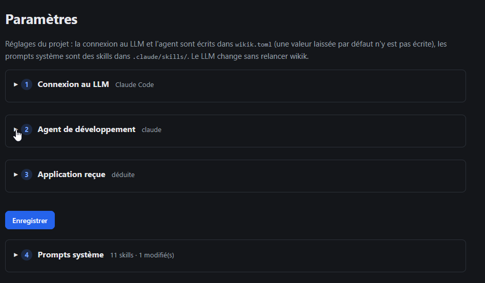

# REC-104.2 : en fait les prompt système en dehors de ceux généraux il faut qu'il soient direc…

en fait les prompt système en dehors de ceux généraux il faut qu'il soient directement dans chaque séction/partie page qui à besoin d'une interaction avec un agent.

