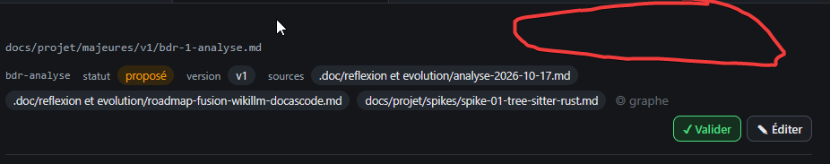

# REC-104.3 : en fait les prompt système en dehors de ceux généraux il faut qu'il soient direc…

en fait les prompt système en dehors de ceux généraux il faut qu'il soient directement dans chaque séction/partie page qui à besoin d'une interaction avec un agent. dans la partie projet j'ai des lien qui revoient dans les paramétre mais en fait il faudra par exemple dans la zone rouge, donc oui présent sur chaque page qui necessite un prompt systéme et une interaction avec agent

## Traitement

**traitee** : Chaque page où un agent intervient a son encart ⚙ repliable pour lire et corriger son prompt système sur place (structure sur chaque document, clarification, traitement de la réception), et les liens ⚙ du volet vers les Paramètres sont retirés.

Commit : `d7cfe9d`
