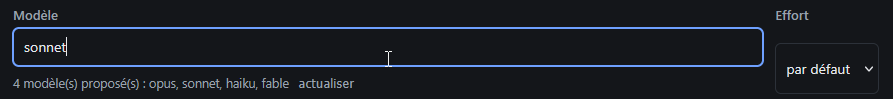

# REC-105 : très moche il me faut un indicateur qui me montre qu'il y a une liste de modèle…

très moche il me faut un indicateur qui me montre qu'il y a une liste de modèle dans cette liste, autre point les deux liste sont pas aligné et la partie modele est disproportionné par rapport à la liste d'efforte

