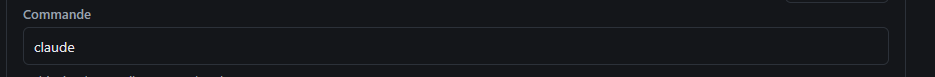
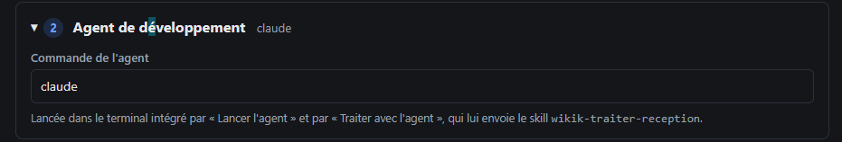

# REC-106 : ça me serre à quoi ces deux partie de commande

ça me serre à quoi ces deux partie de commande

## Traitement

**traitee** : La première commande était le programme du LLM de wikik (utile seulement hors du PATH), passée dans « Réglages avancés », la seconde l'agent lancé dans le terminal, désormais expliquée sous « Agent du terminal ».

Commit : `d7cfe9d`
