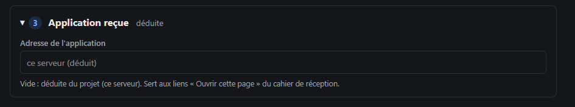

# REC-107 : je n'ai pas besoin d'une autre adresse que le serveur, demande non sollicité alo…

je n'ai pas besoin d'une autre adresse que le serveur, demande non sollicité alors supprime moi ça

## Traitement

**traitee** : Le bloc « Application reçue » et son adresse sont supprimés : l'adresse reste déduite du serveur.

Commit : `d7cfe9d`
