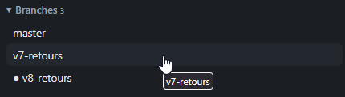

# REC-109 : j'ai une puce devans le v8 c'est moche et inutile, il faut que le distant et le…

j'ai une puce devans le v8 c'est moche et inutile, il faut que le distant et le local se ressemble

## Traitement

**traitee** : Plus de puce devant la branche courante (indiquée en info-bulle), et les branches locales et distantes s'affichent de la même façon, ouvertes toutes les deux.

Commit : `4846cd5`
