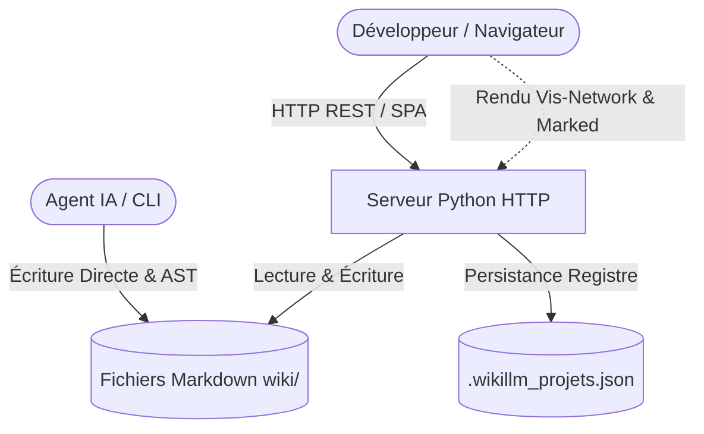

# 🏗️ Architecture & Vue d'ensemble du Système

Ce document décrit l'organisation globale de WikiLLM, ses flux de données et ses composants fondamentaux.

---

## 🧭 Diagramme d'Architecture Globale

WikiLLM établit une passerelle bidirectionnelle en temps réel entre l'agent IA, le développeur et la base de connaissances Markdown :

---

## 🧩 Composants Principaux

### 1. Serveur HTTP & API REST (`serveur.py`)
- **Responsabilité** : Écouter sur les interfaces réseau, servir les ressources statiques (SPA `index.html`), exposer les routes API pour la lecture/écriture des fichiers Markdown et calculer le graphe relationnel.
- **Interfaces** : REST HTTP JSON (`/api/*`), Web Server statique.

> ### 🏛️ Architecture Decision (ADR)
> **Statut** : Accepté  
> **Contexte** : Garantir une portabilité universelle sans risque de conflit d'environnement virtuel ou d'installation de paquets manquants.  
> **Décision** : Utiliser exclusivement la bibliothèque standard Python 3 (`http.server`, `urllib`, `socket`, `json`, `pathlib`).  
> **Conséquences & Trade-offs** :
> - 🟢 **Avantages** : Démarrage immédiat sur n'importe quel OS (Linux, macOS, Windows) sans `pip install`.
> - 🔴 **Limites** : Serveur mono-thread de base (largement suffisant pour un usage local ou équipe restreinte).

---

### 2. Interface Utilisateur Monopage (`index.html`)
- **Responsabilité** : Fournir une interface soignée intégrant un visualiseur Markdown enrichi, un éditeur avec raccourcis clavier, un explorateur multi-projets et un moteur de graphe dynamique.
- **Interfaces** : Intégration CDN pour les librairies de rendu (Marked.js, Highlight.js, Vis-Network, Mermaid.js).

> ### 🏛️ Architecture Decision (ADR)
> **Statut** : Accepté  
> **Contexte** : Offrir une navigation fluide d'une note à l'autre sans rechargement de page complet.  
> **Décision** : Routage côté client (SPA) intercepté par `serveur.py` qui renvoie `index.html` pour toute URI ne comportant pas d'extension de fichier statique.  
> **Conséquences & Trade-offs** :
> - 🟢 **Avantages** : URLs propres (ex: `http://localhost:8000/wikiK/architecture/vue-ensemble`), expérience utilisateur fluide.
> - 🔴 **Limites** : Les assets statiques doivent posséder une extension explicite (`.css`, `.js`, `.png`).

---

### 3. Moteur de Graphe de Connaissances
- **Responsabilité** : Analyser les liens internes Markdown et les wikilinks pour construire un réseau de dépendances et de relations.
- **Syntaxe supportée** : `[[nom_note]]`, `[[dossier/nom_note]]`, `[[cible|libellé]]`, syntaxe standard Markdown `[libellé](chemin)`.

---

## 🔗 Liens Utiles
- [[index|Accueil du Wiki]]
- [[architecture/code-map|Cartographie Complète du Code (Code Map en 1 passe)]]
- [[documentation/guide|Guide d'Utilisation]]
- [[decisions/001-choix-technologiques|ADR 001 - Choix Technologiques]]
- [[taches/backlog|Backlog du projet]]
